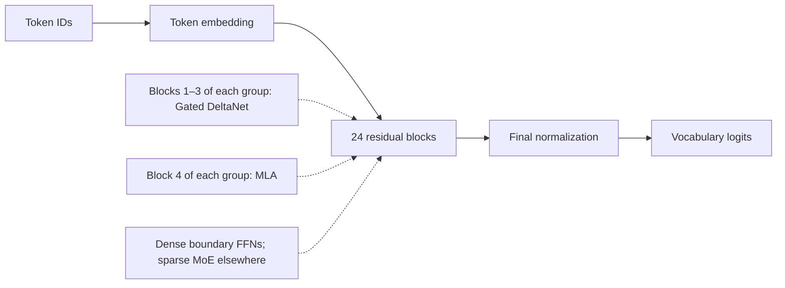

# Cairn: A Hybrid Recurrent–Attention Language Model

Rust implementation of **Cairn**, a decoder-only language model combining recurrent sequence processing, periodic attention, and sparse mixture-of-experts feed-forward layers. This repository contains the current implementation, controlled-study configurations, and stored implementation-validation records. **Work in progress.**

[](https://github.com/skethz/Cairn)
[](#implementation)
[](#results)
[](#release-status)

> **Architecture:** Cairn alternates Gated DeltaNet recurrent blocks with Multi-head Latent Attention (MLA) blocks to combine a compact recurrent state with direct access to earlier tokens. Sparse mixture-of-experts (MoE) layers route each token to selected experts and a shared expert. In the 1.320B-parameter study configuration, 24 blocks follow a three-recurrent/one-attention pattern; the first and last blocks use dense feed-forward layers. The remaining blocks select two of 16 routed experts per token. The Rust runtime uses LibTorch/CUDA, with native C++ and CUDA helpers for selected operations.

## 📑 Contents

1. [Artifact Contents](#artifact-contents)
2. [Architecture](#architecture)
3. [Results](#results)
4. [Implementation](#implementation)
5. [Reproducibility](#reproducibility)
6. [Release Status](#release-status)
7. [Citation](#citation)

## <a name="artifact-contents"></a> 🧩 Artifact Contents

| Path | Contents |
| --- | --- |
| [`rust/src/`](rust/src/) | Model, training, optimizer, data preparation, evaluation, checkpointing, and execution management |
| [`rust/native/`](rust/native/) | C++ bridge, CUDA expert-routing kernels, and build-only CUDA compilation helper |
| [`rust/configs/`](rust/configs/) | Approximately 400M/1.3B study configurations, controls, and separate packed-inference configurations |
| [`rust/verification/`](rust/verification/) | Historical Python comparison tools and retained reference modules; separate from the Rust runtime |
| [`rust/evidence/`](rust/evidence/) | Stored numerical comparisons, build records, and historical training receipts |
| [`docs/validation.md`](docs/validation.md) | Validation scope, current source identity, and reproduction limits |
| [`docs/source_identity.json`](docs/source_identity.json) | Current source hashes compared with the historical optimized-release manifest |
| [`tools/verify_snapshot.py`](tools/verify_snapshot.py) | Standard-library source-identity and manifest verification |
| [`MANIFEST.tsv`](MANIFEST.tsv) | Size and SHA-256 of every released file except the manifest itself |

## <a name="architecture"></a> 🧠 Architecture



The diagram describes the **1.3B study model**, rather than the separate 114-layer packed-inference configuration.

| Component | 1.3B Cairn study configuration |
| --- | --- |
| Total parameters | 1,320,163,008 |
| Width / blocks | 1,024 / 24 |
| Recurrent / attention blocks | 18 Gated DeltaNet / 6 MLA |
| Vocabulary / maximum training context | 32,000 / 4,096 tokens |
| Routed experts / selected per token | 16 / 2, plus one shared expert |
| Router groups / retained groups | 4 / 2 |
| Expert hidden width | 992 |
| Dense feed-forward blocks | First and last; hidden width 3,072 |
| Training precision | FP32 master weights and optimizer state; BF16 matrix autocast; FP32 delta state |
| Multi-token prediction | Disabled in the controlled training configurations |

The 400M Cairn configuration contains 385,379,616 parameters. Controls include GDN-H recipe proxy, KDA + MLA, GDN + GQA, Full MLA, and Dense GQA. Configurations define experiments; their presence does not imply that every experiment has been run.

## <a name="results"></a> 📈 Results

**Stored implementation validation:** short continuations of four approximately 1.3B models matched the retained Python training implementation bit for bit in the saved tensors below. These checks establish agreement over the tested steps; they do not establish general model quality or superiority over another architecture.

| Model | Compared continuation | Matching tensors: weights + optimizer/RNG + final gradients |
| --- | --- | ---: |
| Cairn | Step 1,000 → 1,003 | 7,417 / 7,417 |
| GDN-H recipe proxy | Step 1,000 → 1,002 | 7,387 / 7,387 |
| KDA + MLA | Step 500 → 502 | 7,417 / 7,417 |
| GDN + GQA | Step 1,000 → 1,002 | 7,417 / 7,417 |

Source: [`optimization_summary.json`](rust/evidence/optimization_summary.json).

**Historical training progress:** the 4 November 2026 pause receipt records Cairn at **27,814 updates and 882,864,406 valid tokens**. This includes progress restored from the earlier Python run before Rust continuation. It is a historical receipt, not a currently running job or a released checkpoint. See the [pause receipt](rust/evidence/gpu4_pause_20261104T051200Z/summary.json).

Final quality benchmarks, completed comparisons, and throughput/latency measurements for a reproducible release: **Coming soon.**

## <a name="implementation"></a> 🛠️ Implementation

| Component | Implementation |
| --- | --- |
| Model and training | Rust with `tch` / LibTorch; no Python interpreter in the model runtime |
| Native operations | C++ bridge and custom CUDA integer routing kernels |
| Training controls | Local data, paired initialization, gradient accumulation, activation recomputation, checkpoint resume |
| Execution | `cairn-run` applies OS network restrictions; `cairn-control` manages sequential runs |
| Verification | Separate Python oracle and stored comparison records |
| Packed inference | Separate local FP4 path; not the BF16/FP32 training configuration |

The included build pins `tch` 0.24.0 and requires **LibTorch 2.11.0**; the validated Linux GPU environment used **CUDA 12.8**. Historical records identify Rust 1.99.1. The project is not yet a portable, one-command installation. The launcher currently accepts CPU or GPU indices 4–7.

The [original Rust workspace notes](rust/README.md) retain detailed historical commands and server paths. Those paths describe the former environment and must not be treated as available installations.

## <a name="reproducibility"></a> 🔁 Reproducibility

Verify the released files and their correspondence to the historical source hashes without loading the model:

```sh
python3 tools/verify_snapshot.py
```

To build on a prepared Linux machine, first provision the pinned Rust dependencies in the local Cargo cache, the required LibTorch native tree, and CUDA toolkit. Then:

```sh
cd rust
export LIBTORCH=/path/to/libtorch
export CUDA_HOME=/path/to/cuda-12.8
bash build_offline.sh
./target/release/cairn-run cpu probe
./target/release/cairn-run cpu count configs/cairn_1p3b.json
```

The build runs with `--locked --offline`. Dependency caches and toolchains are not bundled. Data directories in study configurations and paths in the historical oracle launcher require local provisioning. The stored full-scale comparisons cannot be rerun from this repository alone because their checkpoint fixtures, datasets, and full frozen Python training reference are not included.

Current source identity: **37 of 38** source/configuration/build files match the historical optimized-release manifest. The sole mismatch is `rust/src/bin/control.rs`, the execution manager. Later controller tests are recorded, but its current source cannot be tied byte for byte to that later binary from the retained records. All model/training files, native kernels, study configurations, and dependency lockfiles covered by that manifest match. See [validation details](docs/validation.md).

## <a name="release-status"></a> 🚧 Release Status

| Item | Status |
| --- | --- |
| Rust implementation and study configurations | Included |
| Stored validation records and source-identity check | Included |
| Architecture figure | Coming soon. |
| Trained checkpoints | Coming soon. |
| Dataset preparation and portable reproduction package | Coming soon. |
| Final benchmark results and ablations | Coming soon. |
| Paper and citation | Coming soon. |

Historical external-model downloads, their weights, machine environments, and unrelated research drafts are not part of this repository.

## <a name="citation"></a> 📚 Citation

Coming soon.
